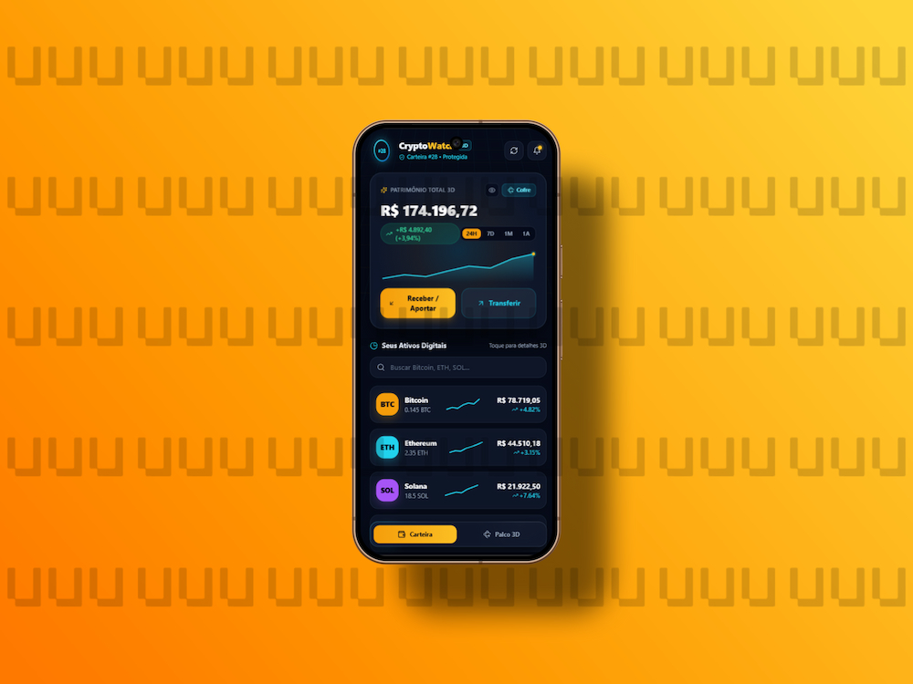
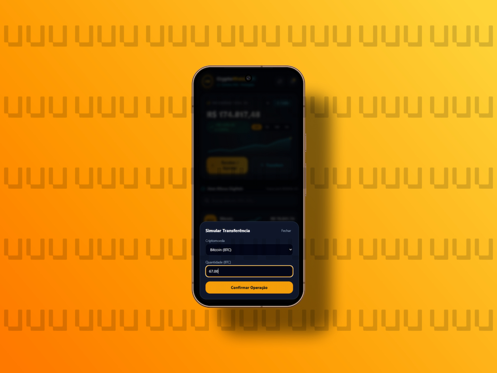

# 📱 CryptoWatch (#28) — Rastreador de Carteira Digital de Criptomoedas

> **Aluno:** #28  
> **Tema:** Rastreador de Carteira Digital de Criptomoedas  
> **Tecnologias:** React 18, TypeScript, Tailwind CSS, Capacitor 6 & GitHub Actions  

---

## 🎯 Sobre o Aplicativo

O **CryptoWatch** é um aplicativo mobile híbrido desenvolvido com **React + TypeScript + Capacitor** para acompanhamento de carteiras digitais de criptomoedas (Bitcoin, Ethereum, Solana, Cardano e Tether).

O projeto aplica práticas completas de **Branding Mobile** e **Automação Nativa**:
- **Interface Interativa em 3D:** Moeda metálica 3D giratória (`CW` / `#28`), cartão principal com inclinação espacial (*3D Tilt*), reflexo holográfico e giro de `180°` para o modo **Cofre Hardware**, além da aba **Palco 3D** com carrossel rotativo de ativos.
- **Identidade Visual Nativa:** Ícone adaptativo (`1024x1024 px`) e Splash Screen (`2732x2732 px`) projetados dentro das **Zonas Seguras (Safe Zones)** do Android e compilados automaticamente em todas as densidades (`mdpi` a `xxxhdpi`) via `@capacitor/assets`.
- **Build Automático na Nuvem (CI/CD):** Workflow configurado no **GitHub Actions** para gerar o instalador Android (`meu-aplicativo-apk`) a cada `push`.

---

## 🎨 Identidade Visual & Paleta de Cores

| Elemento | Especificação | Cor / Detalhe |
| :--- | :--- | :--- |
| **Fundo Principal (Deep Navy)** | `#0B1120` / `#060B19` | Sólido opaco (sem transparência) |
| **Destaque Primário (Gold Amber)** | `#F59E0B` / `#FBBF24` | Emblema monetário e ações principais |
| **Destaque Secundário (Electric Cyan)** | `#06B6D4` / `#22D3EE` | Gráficos de tendência e indicadores positivos |
| **Ícone Base (`/assets/icon.png`)** | `1024 x 1024 px` | Fundo sólido `#0B1120`, sem cantos arredondados manuais, emblema na Safe Zone (66%) |
| **Splash Screen (`/assets/splash.png`)** | `2732 x 2732 px` | Fundo sólido `#0B1120`, logotipo centralizado na área segura (`CENTER_CROP`) |

---

## 📸 Capturas de Tela & Mockups do App

### 1. Mockup do Aplicativo em Execução


### 2. Ícone Nativo na Tela Inicial do Dispositivo


---

## 🚀 Como Executar e Gerar os Recursos Nativos

```bash
# 1. Instalar dependências do projeto
npm install

# 2. Gerar o build web de produção
npm run build

# 3. Adicionar a plataforma Android (caso ainda não exista)
npx cap add android

# 4. Gerar todas as densidades de Ícone e Splash Screen (mdpi a xxxhdpi)
npx capacitor-assets generate --android

# 5. Sincronizar arquivos web e nativos com o projeto Android
npx cap sync android
